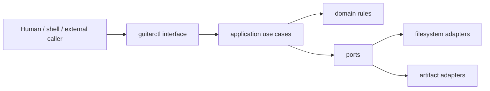

# CLI architecture

`guitarctl` is the stable command surface for Guitar Practice System. The CLI is an interface adapter, not the application architecture.

## Layering

Dependencies point inward:

- `guitar_practice.domain` contains pure deterministic musical/practice rules and value objects.
- `guitar_practice.application` coordinates use cases and defines ports.
- `guitar_practice.adapters` implements bounded side effects and migration bridges.
- `guitar_practice.interfaces.cli` parses arguments, dispatches commands, renders results, and maps failures to exit codes.

The domain must not import CLI, filesystem, network, process, or presentation code.

## Command design

Commands are grouped by capability rather than implementation file:

~~~text
guitarctl
├── discover search
├── schedule propose | check-approval
├── schedule legacy propose | check-approval              [deprecated]
├── assess evaluate
├── session adapt
├── evidence feedback
├── groove validate | list | show
├── progression validate | list | show | resolve | fourths | generate
├── backing resolve | generate | render
├── midi generate | validate | generate-exercises
├── score init | import | form | chords | part add | notes | voicing | rhythm
│         rhythm guide | technique | render | play | edit | show | tracks | validate
├── drums export
├── dsp preset validate | canonicalize
├── artifact build
├── export practice-data
├── release prepare | verify
└── validate repo | public-boundary
~~~

All stable command paths above are package-native use cases. Legacy scheduling v1 is intentionally available only under `schedule legacy` and remains process-backed and deprecated. Direct `scripts/*.py` and `tools/*.py` entrypoints that remain in the tree are compatibility shims, not recommended public interfaces. See `docs/cli.md` for command arguments and examples.

## Stable process contract

The command surface follows these rules:

- stdout contains requested data or artifact locations only;
- stderr contains diagnostics;
- structured commands emit JSON by default;
- exit codes are stable and documented;
- relative paths resolve from one explicit workspace;
- stdin/stdout composition may be added where a command naturally consumes or produces one document;
- no command silently mutates canonical practice state;
- mutation requires an explicit action and the same deterministic validation used by every other caller.

These rules intentionally make the public core straightforward to call from shells, CI, desktop tools, services, or other external orchestration without coupling those callers to Python module topology.

The canonical score namespace follows the same contract. `score init` emits canonical Score IR to stdout unless an explicit `--output` is supplied; `score show`, `score tracks`, and `score validate` require an explicit input document. Authoring transforms such as `score part add`, `score form`, `score chords`, `score notes`, `score voicing`, `score rhythm`, and `score technique` read an explicit source and write to an explicit output. No command infers a current score from ambient workspace state.

The implemented rendering path supports MusicXML and MIDI; `score play` auditions a bounded MIDI realization, and `score edit` is the guided interactive workflow. `backing render` and `drums export --target boss-rc3` use score-derived realizations rather than copying a second score model. `dsp preset` operations author/validate the narrow versioned external control contract; they do **not** send controls to hardware or expose realtime effects as practice-domain logic.

`release prepare` and `release verify` package/validate deterministic practice bundles. The GitHub tag-triggered publisher is implemented, but no public GitHub Release had been published at the 2026-10-11 status review; publishing remains an explicit release decision.

## Migration boundary

The stable-command extraction is complete through #94/#97/#100. The registered legacy-process adapter remains only for explicitly deprecated scheduling v1 commands. It is a contained compatibility boundary, not the normal application architecture.

A registered legacy command contains:

- a canonical `guitarctl` path;
- its temporary repository script target;
- any fixed argument prefix needed to preserve old behavior;
- migration state (`native`, `legacy`, or `deprecated`);
- no arbitrary shell command.

The adapter executes only registered repository-relative Python files and never invokes a shell. Package-native commands bypass this adapter entirely.

## Completed extraction approach

For each cohesive subsystem, the migration applied this sequence:

1. identify deterministic computation and state invariants;
2. move that computation into `domain`;
3. move orchestration into `application`;
4. put filesystem/process/artifact concerns behind adapters;
5. route `guitarctl` to the package-native use case;
6. reduce the old script to a compatibility shim that imports package code;
7. migrate tests from `sys.path`/script imports to package imports;
8. migrate CI and docs to `guitarctl`;
9. delete the shim only after parity evidence exists.

Extraction was by subsystem rather than by file so closely coupled code moved together. The completed order was:

1. discovery;
2. scheduling + assessment;
3. evidence + adaptive sessions;
4. progression + timing;
5. MIDI + groove + bass + backing-track generation;
6. repository validation/export/build tooling.

## Patterns used

- **Functional core / imperative shell**: deterministic rules stay pure; I/O stays at the edge.
- **Ports and adapters / hexagonal architecture**: application code depends on capabilities, not concrete infrastructure.
- **Command pattern**: one registry maps stable command identities to handlers.
- **Strangler pattern**: legacy scripts remain usable while behavior moves behind stable interfaces.
- **Dependency inversion**: filesystem, clock, process, and artifact dependencies point outward.
- **Anti-corruption layer**: the residual legacy adapter translates explicitly deprecated scheduling v1 commands to historical script conventions.

The goal is a boring, reproducible public core with a stable machine-facing surface and no requirement that callers understand repository internals.
